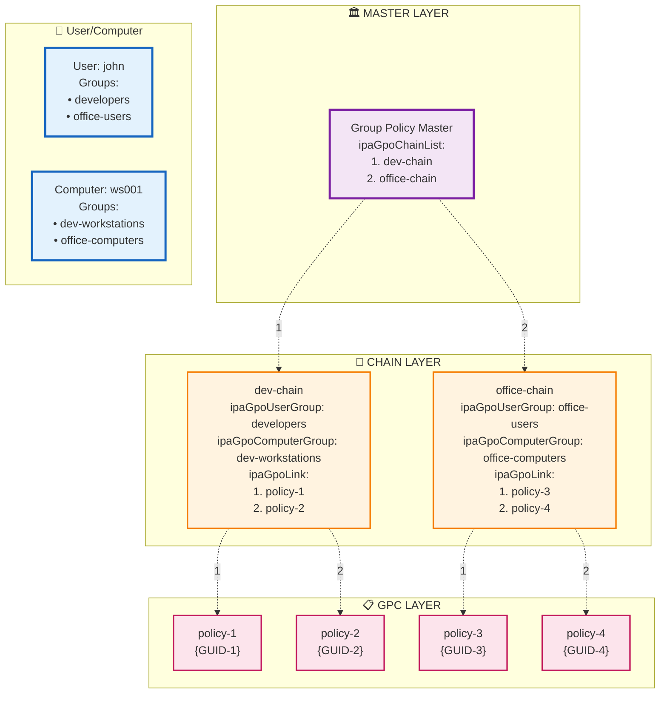

# ipa-gpo-install - Group Policies for FreeIPA

**English** | [Русский](./README.ru.md)

## Description

**ipa-gpo-install** is a tool for integrating group policy functionality into FreeIPA. The package extends the LDAP schema with necessary objects and provides CLI and WEB interfaces for managing group policies.

## Documentation

All documentation is available in English and Russian and lives in [doc/](./doc/README.md) (index: [doc/README.md](./doc/README.md), [Russian](./doc/README.ru.md)):

- [Architecture](./doc/ARCHITECTURE.md) ([Russian](./doc/ARCHITECTURE.ru.md)) - server plugins, installer, `libadmix`, LDAP schema, SYSVOL, web editor
- [Developer setup](./doc/DEV-SETUP.md) ([Russian](./doc/DEV-SETUP.ru.md)) - the podman dev container with a live FreeIPA server, frontend tooling, how to work in VS Code or vim
- [CI](./doc/CI.md) ([Russian](./doc/CI.ru.md)) - build, integration and RPM publication pipeline
- [Frontend](./frontend/README.md) ([Russian](./frontend/README.ru.md)) - the web editor sources, tests and dev stand
- [Plans](./doc/plans/README.md) ([Russian](./doc/plans/README.ru.md)) - proposals for frontend developer experience and for a freeipa-webui migration

## Development

The repository ships a dev container (`.devcontainer/`) with a real FreeIPA server in which your working copy is mounted over the installed plugins, so edits take effect immediately. Typical commands:

    $ sudo .devcontainer/host-setup.sh       # once per machine
    $ make test-python                        # Python tests (inside the container, where FreeIPA libraries exist)
    $ make ui-dev-install && make ui-dev      # web editor on mock data, no FreeIPA needed
    $ make test-ui                            # frontend tests on mocks
    $ make test-ui-ipa                        # frontend tests against the live dev container

See [doc/DEV-SETUP.md](./doc/DEV-SETUP.md) for details.

## How it works

### Group Policy Concept

Group Policies in FreeIPA work on the principle of **multi-level inheritance of settings**. The system consists of three main components:

1. **Policies** - sets of rules and settings

2. **Chains** - linking element that defines policy assignment to user and computer groups and their application sequence

3. **Group Policy Master** - object that stores ordered list of all chains in the system and defines the main server for policy management

#### Policy Priority Determination

When a user logs into the system, policies are applied in a strictly defined sequence:

1. **Chain processing** - system processes chains in the order specified in the Group Policy Master
2. **Membership filtering** - for each chain, system checks if it matches the current user and computer
3. **Policy priority within chain** - if chain matches, policies from it are processed in the order of their sequence in the `ipaGpoLink` attribute

#### Priority Management

Priorities are configured at two levels:

**Chain level in Master:**
- Chain order is determined by their position in the `ipaGpoChainList` attribute of the master
- Chains higher in the list have higher priority

**Policy level within chain:**
- Policy order is determined by their position in the `ipaGpoLink` attribute of the chain
- Policies higher in the list have higher priority
- In case of setting conflicts, the policy with higher priority takes effect

### Implementation Structure

#### Group Policy Container (GPC)
Container with settings and rules. Each GPC contains:
- Unique identifier (GUID)
- Name
- Reference to settings directory in Sysvol
- Policy version for tracking changes

#### Group Policy Chain
Linking element between groups and policies. Chain defines:
- Which user group will receive settings
- Which computer group will receive settings
- Which specific policies are linked to user and computer groups
- In what order policies are applied to members of linked groups

#### Group Policy Master
Central management object that:
- Maintains registry of all active chains in the system
- Defines the main server for policy management
- Maintains correct chain processing order

Master ensures consistency and coordination of the entire group policy system.

### Group Policy Inheritance Scheme



The diagram demonstrates the group policy inheritance process using the example of user `john` and computer `ws001`.

#### Group Membership

**User john** belongs to groups:
- `developers`
- `office-users`

**Computer ws001** belongs to groups:
- `dev-workstations`
- `office-computers`

#### Determining Suitable Chains

Since the user and computer belong to groups from **both** chains, the system identifies two suitable chains:

1. **dev-chain** - matches because:
   - john ∈ developers (ipaGpoUserGroup)
   - ws001 ∈ dev-workstations (ipaGpoComputerGroup)

2. **office-chain** - matches because:
   - john ∈ office-users (ipaGpoUserGroup)
   - ws001 ∈ office-computers (ipaGpoComputerGroup)

#### Policy Sequence

**Step 1: Chain Order**
Group Policy Master defines processing order through the `ipaGpoChainList` attribute:
```
1. dev-chain (first in list)
2. office-chain (second in list)
```

**Step 2: Policies from dev-chain**
In order of `ipaGpoLink` attribute:
```
1. policy-1 (priority 1)
2. policy-2 (priority 2)
```

**Step 3: Policies from office-chain**
In order of `ipaGpoLink` attribute:
```
3. policy-3 (priority 1)
4. policy-4 (priority 2)
```

#### Final Sequence

User `john` on computer `ws001` will receive policies in the following order:
```
policy-1 → policy-2 → policy-3 → policy-4
```

#### Sequence Explanation

1. **First all policies from dev-chain** - because this chain is first in master's `ipaGpoChainList`
2. **Then all policies from office-chain** - because this chain is second in master's `ipaGpoChainList`
3. **Within each chain** policies are in the order of their sequence in `ipaGpoLink`
4. **In case of setting conflicts** the policy with the higher priority takes precedence, i.e. the one higher in the list (in this case policy-1; `ipa chain-mod --moveup-gpc` raises a policy's priority)

This approach provides predictable and controlled policy inheritance with flexible priority management at two levels: chain level and policy level within chain.

## Installation

### Requirements

- FreeIPA server
- `python3-module-admix` 0.3.x (at least 0.3.0 and below 0.4.0)
- Administrative Templates provided by `admx-basealt`
- `sdmx-basealt` (at least 1.0.0) and `sdmx-schemas` (at least 1.0.0)
- Administrator rights
- Valid Kerberos ticket

The RPM package also depends on `freeipa-server-core`, `freeipa-server-trust-ad`, `samba-common-tools` and `acl`.

## Installing RPM package
    # apt-get install freeipa-server-gpo

## Getting Kerberos ticket
    # kinit admin

## Configuring group policies
    # ipa-gpo-install

### Installation parameters

    # ipa-gpo-install [OPTIONS]

Options:
  --debuglevel LEVEL   Debug level: 0=errors, 1=warnings, 2=debug
  --check-only         Check only without making changes
  --help               Show help

### What the installer does

1. **Verifying the installed assets** - checks that the policy update files are in place
2. **Installing AD Trust** - only if it is not enabled yet
3. **Creating the SYSVOL directory and the SYSVOL share** - directories for policy files and the Samba share (only when missing)
4. **Preparing the web editor** - grants the FreeIPA `ipaapi` service account
   controlled access to GPO payloads and creates its private publication state
   directory
5. **Activating the plugins** - checks that the Python plugins, UI files, schema, update and D-Bus handler files are installed
6. **Restarting oddjob** and, if the LDAP schema or infrastructure is incomplete,
   **running `ipa-server-upgrade`** to extend the LDAP schema with the group policy object classes
7. **Verifying** the schema and the LDAP infrastructure, then reloading Apache so that it picks up the new commands

Use `--check-only` to see what would be done without changing anything.

## Technical implementation

### LDAP Schema
**ipaGpoContainer (GPC)**
- `cn` - Policy GUID
- `displayName` - Display name of policy
- `distinguishedName` - Object DN
- `ipaGpoFlags` - Policy flags
- `ipaGpoFileSysPath` - Path to policy files in SYSVOL
- `ipaGpoVersionNumber` - Policy version number
- `ipaGpoMachineExtensionNames` - Published machine-side policy extensions
- `ipaGpoUserExtensionNames` - Published user-side policy extensions

**ipaGpoChain**
- `cn` - Chain name
- `description` - Description of the chain
- `ipaGpoUserGroup` - User group DN
- `ipaGpoComputerGroup` - Computer group DN
- `ipaGpoLink` - Ordered list of policy DNs

**ipaGpoMaster**
- `cn` - Master object name (`grouppolicymaster`)
- `ipaGpoPdcEmulator` - PDC emulator server name
- `ipaGpoChainList` - Ordered list of policy chains

### Web editor architecture

The authenticated FreeIPA server plugin uses the `libadmix` Python binding
directly. The browser exchanges typed policy and preference objects and never
submits SYSVOL or registry paths. File changes are committed atomically by
`libadmix`; the plugin publishes the resulting packed version and extension
attributes to LDAP with a snapshot assertion before acknowledging the commit.

The editor frontend is built from `frontend/` into one bundle,
`frontend/dist/js/app.js` (see [frontend/README.md](./frontend/README.md)).

## Management commands

### Policy management

#### Creating policy
    # ipa gpo-add office-security-policy

#### Viewing policy
    # ipa gpo-show office-security-policy

#### Modifying policy
    # ipa gpo-mod office-security-policy --rename="new-security-policy"

#### Deleting policy
    # ipa gpo-del new-security-policy

#### Finding policies
    # ipa gpo-find [CRITERIA]

### Policy chain management

#### Creating chain
    # ipa chain-add it-chain \
    --desc="IT Department Chain" \
    --user-group=it-users \
    --computer-group=it-workstations \
    --gp-link=policy1

#### Viewing chain
    # ipa chain-show it-chain --raw

### Modifying chain

**Basic modifications:**
    # ipa chain-mod it-chain \
    --desc="New description" \
    --user-group=new-user-group \
    --computer-group=new-computer-group
    # ipa chain-mod it-chain --rename=new-chain-name

**Adding groups:**
    # ipa chain-mod it-chain --add-user-group=developers
    # ipa chain-mod it-chain --add-computer-group=dev-machines

**Removing groups:**
    # ipa chain-mod it-chain --remove-user-group
    # ipa chain-mod it-chain --remove-computer-group

**Working with policies in chain:**

### Adding policies
    # ipa chain-add-gpo it-chain --gpos security-policy
    # ipa chain-add-gpo it-chain --gpos printer-policy

### Removing policies
    # ipa chain-remove-gpo it-chain --gpos security-policy

### Enabling and disabling a chain
    # ipa chain-disable it-chain
    # ipa chain-enable it-chain

### Deleting chain
    # ipa chain-del it-chain

### Finding chains
    # ipa chain-find [CRITERIA]

## Priority management

### Viewing current order
    # ipa chain-show policy-chain

### Moving policy up (increasing priority)
    # ipa chain-mod it-chain --moveup-gpc="security-policy"

### Moving policy down (decreasing priority)
    # ipa chain-mod it-chain --movedown-gpc="security-policy"

## Group Policy Master management

#### Viewing Group Policy Master
    # ipa gpmaster-show

The master object is named `grouppolicymaster`; use that name as `master-name` below.

#### Adding chain to master
    # ipa gpmaster-mod master-name --add-chain=chain-name

#### Removing chain from master
    # ipa gpmaster-mod master-name --remove-chain=chain-name

### Moving chain up (increasing priority)
    # ipa gpmaster-mod master-name --moveup-chain=chain-name

### Moving chain down (decreasing priority)
    # ipa gpmaster-mod master-name --movedown-chain=chain-name

### Configuring PDC Emulator
    # ipa gpmaster-mod master-name --pdc-emulator=server-name

## Web interface

The extension includes a full-featured web interface integrated into the FreeIPA administrative panel.

### Main features

- **Policy chain management**: creation, editing, enabling/disabling
- **Priority management**: changing chain and GPO order
- **GPO object management**: creation, editing, deletion with automatic file structure processing
- **Group linking**: assigning chains to user and computer groups
- **Policy editor (GPUI)**: opened from the GPO page; edits administrative templates (ADMX), preferences, scripts, security settings and advanced audit. It talks to the server only through typed `gpo_editor_*` RPC calls and never sees SYSVOL paths

### Integration

- New "Group Policy" section in FreeIPA menu
- Support for access rights system with "Group Policy Administrators" role
- Standard FreeIPA interface components

## File structure

### SYSVOL
After installation, directory structure is created:
```
/var/lib/freeipa/sysvol/
├── domain.example.com/
│ ├── Policies/
│ │ ├── {GUID}/
│ │ │ ├── GPT.INI
│ │ │ ├── Machine/
│ │ │ └── User/
```


### Policy files
Each policy creates structure in SYSVOL:
- `GPT.INI` - policy metadata
- `Machine/` - settings for computers
- `User/` - settings for users

## Access rights

### Roles and privileges
System creates the role **Group Policy Administrators** (it holds the privilege of the same name) with rights:
- Read all group policy objects
- Create, modify and delete policies
- Manage policy chains

### Assigning rights
    # ipa role-add-member "Group Policy Administrators" --users=username

## System features

### Data integrity verification

**When adding objects:**
- Adding GPC and groups is performed with verification of their existence in LDAP database

**When deleting objects:**
- When deleting GPC or groups, references in chains are automatically removed by referential integrity plugin
- When deleting chain, it is automatically removed from gpmaster object
