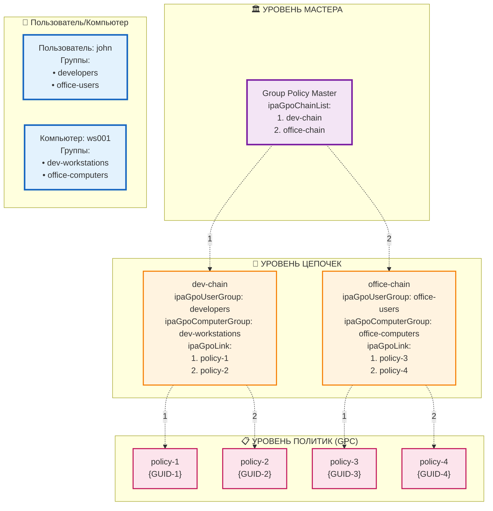

# ipa-gpo-install - Групповые политики для FreeIPA

[English](./README.md) | **Русский**

## Описание

**ipa-gpo-install** — это инструмент для интеграции функций групповых политик в FreeIPA. Пакет расширяет схему LDAP необходимыми объектами и предоставляет CLI и WEB интефрейсы для управления групповыми политиками.

## Документация

Вся документация есть на русском и английском языках и находится в каталоге [doc/](./doc/README.ru.md) (оглавление: [doc/README.ru.md](./doc/README.ru.md), [English](./doc/README.md)):

- [Архитектура](./doc/ARCHITECTURE.ru.md) ([English](./doc/ARCHITECTURE.md)) — серверные плагины, установщик, `libadmix`, схема LDAP, SYSVOL, веб-редактор
- [Окружение разработчика](./doc/DEV-SETUP.ru.md) ([English](./doc/DEV-SETUP.md)) — dev-контейнер podman с живым FreeIPA, инструменты фронтенда, работа в VS Code и vim
- [CI](./doc/CI.ru.md) ([English](./doc/CI.md)) — сборка, интеграционные тесты и публикация RPM
- [Фронтенд](./frontend/README.ru.md) ([English](./frontend/README.md)) — исходники веб-редактора, тесты и стенд
- [Планы](./doc/plans/README.ru.md) ([English](./doc/plans/README.md)) — предложения по улучшению опыта разработки фронтенда и по миграции в freeipa-webui

## Разработка

В репозитории есть dev-контейнер (`.devcontainer/`) с настоящим сервером FreeIPA, в который рабочая копия смонтирована поверх установленных плагинов, поэтому правки применяются сразу. Основные команды:

    $ sudo .devcontainer/host-setup.sh       # один раз на машине
    $ make test-python                        # Python-тесты (в контейнере, где есть библиотеки FreeIPA)
    $ make ui-dev-install && make ui-dev      # веб-редактор на тестовых данных, FreeIPA не нужен
    $ make test-ui                            # тесты фронтенда на моках
    $ make test-ui-ipa                        # тесты фронтенда на живом dev-контейнере

Подробности: [doc/DEV-SETUP.ru.md](./doc/DEV-SETUP.ru.md).

## Как это работает

### Концепция групповых политик

Групповые политики в FreeIPA работают по принципу **многоуровневого наследования настроек**. Система состоит из трех основных компонентов:

1. **Политики** — это наборы правил и настроек

2. **Цепочки** — это связующее звено, которое определяет принадлежность политик к группе пользователей и хостов и последовательность их применения

3. **Мастер групповых политик** — объект, который хранит упорядоченный список всех цепочек в системе и определяет главный сервер для управления политиками

#### Определение приоритетности политик

Когда пользователь входит в систему, политики применяются в строго определенной последовательности:

1. **Обработка цепочек** — система просматривает цепочки в том порядке, в котором они указаны в мастере групповых политик
2. **Фильтрация по принадлежности** — для каждой цепочки проверяется, подходит ли она текущему пользователю и компьютеру
3. **Приоритетность политик внутри цепочки** — если цепочка подходит, политики из неё вычисляются в порядке их следования в атрибуте `ipaGpoLink`

#### Управление приоритетами

Приоритеты настраиваются на двух уровнях:

**Уровень цепочек в мастере:**
- Порядок цепочек определяется их позицией в атрибуте `ipaGpoChainList` мастера
- Цепочки, находящиеся выше в списке, имеют более высокий приоритет

**Уровень политик внутри цепочки:**
- Порядок политик определяется их позицией в атрибуте `ipaGpoLink` цепочки
- Политики, находящиеся выше в списке, имеют более высокий приоритет
- При конфликте настроек действует политика с более высоким приоритетом

### Устройство реализации

#### Group Policy Container (GPC) — Контейнер политик
Контейнер с настройками и правилами. Каждый GPC содержит:
- Уникальный идентификатор (GUID)
- Название
- Ссылку на директорию с файлами настроек в Sysvol
- Версию политики для отслеживания изменений


#### Group Policy Chain — Цепочка политик
Связующий элемент между группами и политиками. Цепочка определяет:
- Какая группа пользователей получит настройки
- Какая группа компьютеров получит настройки
- Какие именно политики связаны с группами пользователей и машин
- В каком порядке политики получает участники связанных групп


#### Group Policy Master — Мастер групповых политик
Центральный объект управления, который:
- Ведет реестр всех активных цепочек в системе
- Определяет главный сервер для управления политиками
- Поддерживает правильный порядок обработки цепочек

Master обеспечивает согласованность и координацию всей системы групповых политик.

### Схема наследования групповых политик



Схема демонстрирует процесс наследования групповых политик на примере пользователя `john` и компьютера `ws001`.

#### Принадлежность к группам

**Пользователь john** входит в группы:
- `developers`
- `office-users`

**Компьютер ws001** входит в группы:
- `dev-workstations`
- `office-computers`

#### Определение подходящих цепочек

Поскольку пользователь и компьютер входят в группы из **обеих** цепочек, система определяет две подходящие цепочки:

1. **dev-chain** - подходит, так как:
   - john ∈ developers (ipaGpoUserGroup)
   - ws001 ∈ dev-workstations (ipaGpoComputerGroup)

2. **office-chain** - подходит, так как:
   - john ∈ office-users (ipaGpoUserGroup)
   - ws001 ∈ office-computers (ipaGpoComputerGroup)

#### Последовательность политик

**Шаг 1: Порядок цепочек**
Group Policy Master определяет порядок обработки через атрибут `ipaGpoChainList`:
```
1. dev-chain (первая в списке)
2. office-chain (вторая в списке)
```

**Шаг 2: Политики из dev-chain**
Находятся в порядке атрибута `ipaGpoLink`:
```
1. policy-1 (приоритет 1)
2. policy-2 (приоритет 2)
```

**Шаг 3: Политики из office-chain**
Находятся в порядке атрибута `ipaGpoLink`:
```
3. policy-3 (приоритет 1)
4. policy-4 (приоритет 2)
```

#### Итоговая последовательность

Пользователь `john` на компьютере `ws001` получит политики в следующем порядке:

```
policy-1 → policy-2 → policy-3 → policy-4
```

#### Объяснение последовательности

1. **Сначала все политики из dev-chain** - потому что эта цепочка идет первой в `ipaGpoChainList` мастера
2. **Затем все политики из office-chain** - потому что эта цепочка идет второй в `ipaGpoChainList` мастера
3. **Внутри каждой цепочки** политики находятся в порядке их следования в `ipaGpoLink`
4. **При конфликте настроек** приоритетнее политика с более высоким приоритетом, то есть расположенная выше в списке (в данном случае policy-1; `ipa chain-mod --moveup-gpc` повышает приоритет политики)

Такой подход обеспечивает предсказуемое и контролируемое наследование политик с возможностью гибкого управления приоритетами на двух уровнях: уровне цепочек и уровне политик внутри цепочки.


## Установка

### Требования

- FreeIPA сервер
- `python3-module-admix` 0.3.x (не ниже 0.3.0 и ниже 0.4.0)
- Административные шаблоны из пакета `admx-basealt`
- `sdmx-basealt` (не ниже 1.0.0) и `sdmx-schemas` (не ниже 1.0.0)
- Права администратора
- Действующий Kerberos-билет

RPM-пакет также зависит от `freeipa-server-core`, `freeipa-server-trust-ad`, `samba-common-tools` и `acl`.

## Установка RPM пакета
    # apt-get install freeipa-server-gpo

## Получение Kerberos-билета
    # kinit admin

## Настройка групповых политик
    # ipa-gpo-install

### Параметры установки

ipa-gpo-install [OPTIONS]

Опции:
  --debuglevel LEVEL    Уровень отладки: 0=ошибки, 1=предупреждения, 2=отладка
  --check-only          Только проверка без внесения изменений
  --help               Показать справку

### Что делает установщик

1. **Проверка установленных файлов** — убеждается, что файлы обновления групповых политик на месте
2. **Установка AD Trust** — только если он ещё не включён
3. **Создание каталога и общего ресурса SYSVOL** — каталоги для файлов политик и ресурс Samba (только если их нет)
4. **Подготовка веб-редактора** — выдаёт сервисному пользователю FreeIPA
   `ipaapi` ограниченный доступ к содержимому GPO и создаёт приватный каталог
   состояния публикации
5. **Активация плагинов** — проверяет, что установлены Python-плагины, файлы UI, схема, файлы обновлений и обработчики D-Bus
6. **Перезапуск oddjob** и, если схема LDAP или инфраструктура неполны,
   **запуск `ipa-server-upgrade`** — расширяет схему LDAP классами объектов групповых политик
7. **Проверка** схемы и инфраструктуры LDAP, затем перезагрузка Apache, чтобы он подхватил новые команды

Опция `--check-only` показывает, что было бы сделано, без изменений.


## Техническая реализация

### Схема LDAP
**ipaGpoContainer (GPC)**
- `cn` — GUID политики
- `displayName` — отображаемое имя политики
- `distinguishedName` — DN объекта
- `ipaGpoFlags` — флаги политики
- `ipaGpoFileSysPath` — путь к файлам политики в SYSVOL
- `ipaGpoVersionNumber` — номер версии политики
- `ipaGpoMachineExtensionNames` — опубликованные расширения машинной части политики
- `ipaGpoUserExtensionNames` — опубликованные расширения пользовательской части политики

**ipaGpoChain**
- `cn` — имя цепочки
- `description` — описание цепочки
- `ipaGpoUserGroup` — DN группы пользователей
- `ipaGpoComputerGroup` — DN группы компьютеров
- `ipaGpoLink` — упорядоченный список DN политик

**ipaGpoMaster**
- `cn` — имя мастер-объекта (`grouppolicymaster`)
- `ipaGpoPdcEmulator` — имя сервера PDC эмулятора
- `ipaGpoChainList` — упорядоченный список цепочек политик

### Архитектура веб-редактора

Аутентифицированный серверный плагин FreeIPA напрямую использует Python binding
`libadmix`. Браузер обменивается типизированными объектами политик и preferences
и не передаёт пути SYSVOL или реестра. `libadmix` атомарно фиксирует изменения
файлов, после чего плагин условно публикует packed version и атрибуты расширений
в LDAP и подтверждает публикацию.

Фронтенд редактора собирается из `frontend/` в один бандл
`frontend/dist/js/app.js` (см. [frontend/README.md](./frontend/README.md)).

## Команды управления

### Управление политиками

#### Создание политики

    # ipa gpo-add office-security-policy

#### Просмотр политики

    # ipa gpo-show office-security-policy

#### Изменение политики

    # ipa gpo-mod office-security-policy --rename="new-security-policy"

#### Удаление политики

    # ipa gpo-del new-security-policy

#### Поиск политик

    # ipa gpo-find [CRITERIA]

### Управление цепочками политик

#### Создание цепочки

    # ipa chain-add it-chain \
  --desc="IT Department Chain" \
  --user-group=it-users \
  --computer-group=it-workstations \
  --gp-link=policy1

#### Просмотр цепочки

    # ipa chain-show it-chain --raw

### Изменение цепочки

**Базовые изменения:**

    # ipa chain-mod it-chain \
  --desc="New description" \
  --user-group=new-user-group \
  --computer-group=new-computer-group
    # ipa chain-mod it-chain --rename=new-chain-name

**Добавление групп:**

    # ipa chain-mod it-chain --add-user-group=developers
    # ipa chain-mod it-chain --add-computer-group=dev-machines

**Удаление групп:**

    # ipa chain-mod it-chain --remove-user-group
    # ipa chain-mod it-chain --remove-computer-group

**Работа с политиками в цепочке:**

### Добавление политик
    # ipa chain-add-gpo it-chain --gpos security-policy
    # ipa chain-add-gpo it-chain --gpos printer-policy

### Удаление политик
    # ipa chain-remove-gpo it-chain --gpos security-policy

### Включение и отключение цепочки
    # ipa chain-disable it-chain
    # ipa chain-enable it-chain

### Удаление цепочки
    # ipa chain-del it-chain

### Поиск цепочек
    # ipa chain-find [CRITERIA]

## Управление приоритетами

### Просмотр текущего порядка
    # ipa chain-show policy-chain

### Перемещение политики вверх (повышение приоритета)
    # ipa chain-mod it-chain --moveup-gpc="security-policy"

### Перемещение политики вниз (понижение приоритета)
    # ipa chain-mod it-chain --movedown-gpc="security-policy"

## Управление мастером групповых политик

#### Просмотр мастера групповых политик

    # ipa gpmaster-show

Мастер-объект называется `grouppolicymaster`; это имя подставляется вместо `master-name` ниже.

#### Добавление цепочки в мастер

    # ipa gpmaster-mod master-name --add-chain=chain-name

#### Удаление цепочки из мастера
    # ipa gpmaster-mod master-name --remove-chain=chain-name

### Перемещение цепочки вверх (повышение приоритета)
    # ipa gpmaster-mod master-name --moveup-chain=chain-name

### Перемещение цепочки вниз (понижение приоритета)
    # ipa gpmaster-mod master-name --movedown-chain=chain-name

### Настройка PDC Emulator
    # ipa gpmaster-mod master-name --pdc-emulator=server-name

## Веб-интерфейс

Расширение включает полнофункциональный веб-интерфейс, интегрированный в административную панель FreeIPA.

### Основные возможности

- **Управление цепочками политик**: создание, редактирование, включение/отключение
- **Управление приоритетами**: изменение порядка цепочек и GPO
- **Управление объектами GPO**: создание, редактирование, удаление с автоматической обработкой файловой структуры
- **Редактор политик (GPUI)**: открывается со страницы GPO; редактирует административные шаблоны (ADMX), preferences, скрипты, параметры безопасности и расширенный аудит. Обращается к серверу только через типизированные RPC-вызовы `gpo_editor_*` и не видит пути SYSVOL

### Интеграция

- Новый раздел "Group Policy" в меню FreeIPA
- Поддержка системы прав доступа с ролью "Group Policy Administrators"
- Стандартные компоненты интерфейса FreeIPA

## Структура файлов

### SYSVOL
После установки создается структура каталогов:
```
/var/lib/freeipa/sysvol/
├── domain.example.com/
│ ├── Policies/
│ │ ├── {GUID}/
│ │ │ ├── GPT.INI
│ │ │ ├── Machine/
│ │ │ └── User/
```

### Файлы политик
Каждая политика создает в SYSVOL структуру:
- `GPT.INI` — метаданные политики
- `Machine/` — настройки для компьютеров
- `User/` — настройки для пользователей

## Права доступа

### Роли и привилегии
Система создаёт роль **Group Policy Administrators** (она включает одноимённую привилегию) с правами:
- Чтение всех объектов групповых политик
- Создание, изменение и удаление политик
- Управление цепочками политик

### Назначение прав

    # ipa role-add-member "Group Policy Administrators" --users=username

## Особенности работы системы

### Проверка целостности данных

**При добавлении объектов:**
- Добавление GPC и групп происходит с проверкой на их существование в базе LDAP

**При удалении объектов:**
- При удалении GPC или групп ссылки в цепочках автоматически удаляются плагином ссылочной целостности
- При удалении цепочки она автоматически удаляется из объекта gpmaster
